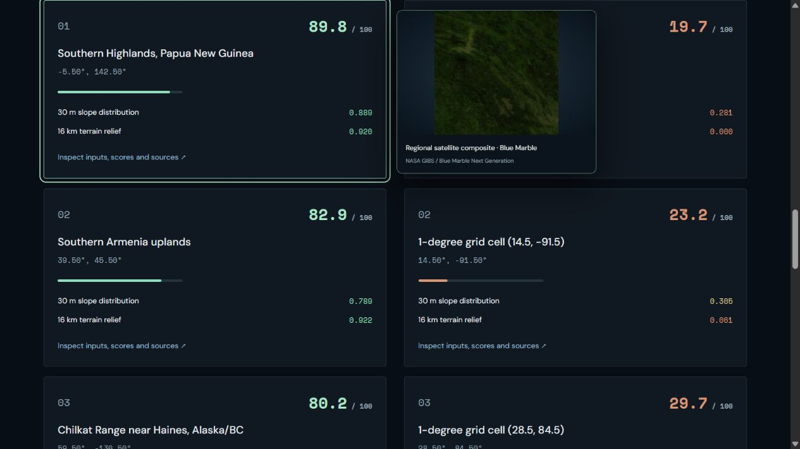
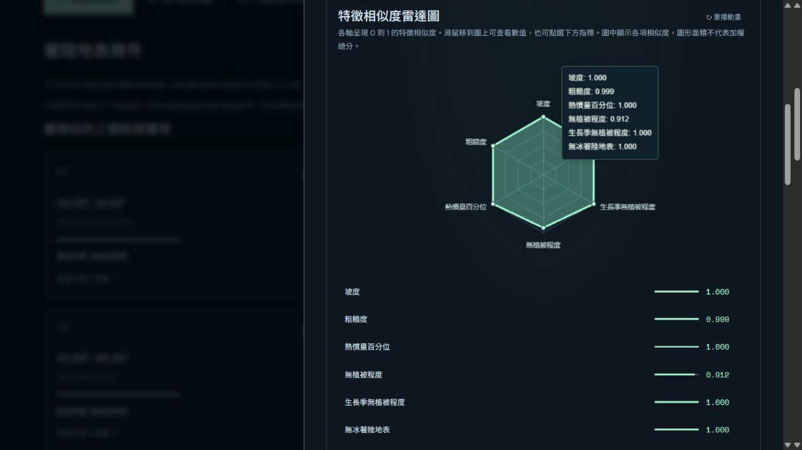

# Earth Analog Finder

**Find Earth environments for testing technologies and planning research for the Moon and Mars.**

Earth Analog Finder is a NASA Space Apps Challenge 2026 team prototype that connects planetary mission requirements with terrestrial analog environments. Choose a mission task, explore the relevant lunar or Martian study areas, and compare Earth locations using environmental data and explainable similarity scores. The system helps teams shortlist test environments, inspect the evidence behind a ranking, and plan a network of complementary Earth test sites.

[Watch the 30-second project video](video/EarthAnalogFinder_30s.mp4)

## What you can do

- **Explore by mission purpose.** Start with the conditions an experiment needs, such as low-angle sunlight, extreme cold, difficult terrain, subsurface ice, minerals, or dust.
- **Compare contrasting environments.** View the three most-similar new Earth candidates alongside the three least-similar locations, with additional rankings and known-analog validation results available to inspect.
- **Understand each score.** Open a location's evidence drawer to see feature similarities, available inputs, formulas, data sources, and an animated, interactive radar chart.
- **See the locations.** Preview regional imagery by hovering over or focusing an Earth candidate. Open lunar site information and images, and explore candidate locations on maps.
- **Plan a Mars test network.** Find a minimum set of Earth locations covering the selected target's evaluated tests within the supplied candidate pool.
- **Read in either language.** Switch between English and Traditional Chinese throughout the website. The language button remembers your choice.

## Explore the Moon

The Moon explorer starts with four mission tasks.

| Mission task | Conditions compared |
|---|---|
| Low-sun illumination and solar power | Noon solar elevation and the fraction of daylight at low solar angles |
| Long darkness and extreme cold | Continuous darkness, minimum monthly nighttime surface temperature, and day-night temperature difference |
| Steep-slope and extreme-terrain mobility | Slope distribution and terrain relief within a 16 km study window |
| Cold-trap ice resource prospecting | Mean and maximum monthly surface temperature, plus a frozen-ground proxy |

Each task page presents two stages.

1. **Explore lunar suitability.** Inspect the team's priority, conditional, and insufficient-evidence assessments across ten lunar reference areas. Click a site to view its information, credited imagery, coordinates, and research sources.
2. **Compare Earth environments.** Inspect the three most-similar new candidates and three least-similar comparisons, then open the map, additional candidates, or known-analog validation group.

Terrain rankings use the selected lunar site's own reference. The other three tasks use shared Earth-achievable environmental anchors. The page explains the team-defined feature weights, their purpose-based rationale, data-fitness adjustments, and the separate 120-hour continuous-darkness check.



*Earth candidate cards show feature similarities and a fading regional image preview on hover or keyboard focus.*

## Explore Mars

The Mars explorer follows a three-step workflow.

1. **Choose tests.** Select landing surface conditions, shallow subsurface ice exploration, hydrated mineral identification, glacial and periglacial terrain, or dust and near-surface weather. The visual-navigation option displays its current data-availability status.
2. **Choose a study area.** Explore Jezero, Gale, Arcadia, Oxia, Meridiani, Protonilus, or AP-105 and their applicable tests.
3. **Compare and plan.** Inspect task-specific Earth rankings, top-versus-bottom comparisons, known analogs, the optional global score map, and a five-dimension environmental profile covering terrain, surface, environment, water/ice, and atmosphere/dust.

The current Mars dataset contains **27 scored target/test pairs**. Ice-related tests use the supplied SWIM ice-consistency eligibility rule. Each scored task combines its applicable feature similarities using an equal-weight geometric mean.

The planning section selects a minimum-cardinality Earth test network from the supplied pool. Its relative coverage threshold is 90% of each demand's best pool score. You can inspect coverage for the selected target and tests, plus the supplied all-target reference network.



*The evidence drawer plots individual feature similarities on a 0–1 scale. Chart tooltips, indicator selection, and replayable animation help explain the candidate's environmental profile. This screenshot shows the Traditional Chinese interface.*

## Data and explainable comparisons

The website brings together the team's reviewed lunar and Mars result packages, source metadata, and credited imagery. Each explorer exposes the method and evidence supporting its comparisons.

| Area | Current inputs and approach |
|---|---|
| Moon | 19,599 global land cells, a MODIS permanent-snow/ice mask, ten lunar terrain references, and 2023 MODIS Terra monthly surface-temperature summaries derived through NASA Worldview/GIBS |
| Mars | Reviewed Earth/Mars comparisons using MODIS, MERRA-2, ASTER, USGS terrain and geology, TES, SWIM, Mars Climate Database, and complementary permafrost, glacier, lithology, and aridity datasets |
| Lunar scoring | Feature similarities aggregated with team-defined weights and supplied data-fitness coefficients |
| Mars scoring | Equal-weight geometric mean of all applicable feature similarities, with a 0.01 floor |
| Evidence | Per-feature values and similarities where supplied, source links, observation coverage, proxy labels, and downloadable results |

The comparisons support regional screening and experiment planning. Spatial resolution, observation periods, missing inputs, and proxy definitions determine how each result can be used. Lunar thermal inputs are monthly surface-temperature summaries, and the current ice-resource indicator is a temperature-based frozen-ground proxy. The method pages document these details alongside the weighting rationale and formulas.

The **Method**, **Data Sources**, and **Research Plan** pages provide bilingual explanations, dataset provenance, and research context. Regional imagery includes NASA GIBS/Worldview products, with individual credits available in the interface.

- [Lunar data and comparison method](docs/LUNAR_METHOD.md)
- [Lunar feature weights and rationale](data/content/lunar-weights.en.md)
- [Current MODIS temperature method](data/content/lunar-modis.en.md)
- [Mars data and comparison method](docs/MARS_METHOD.md)
- [Earth imagery and radar behavior](docs/EARTH_IMAGERY.md)

## Run locally

Install Docker Desktop, start it with Linux containers, and run these commands in a terminal.

```bash
git clone https://github.com/77bigsun/nasa.git
cd nasa
docker compose up --build -d
docker compose ps
```

If you already have the repository, run the Compose commands from its root folder. Open [http://localhost:8080](http://localhost:8080) once the services are healthy.

The default configuration works immediately. To choose another port, copy `.env.example` to `.env` and set `PORT`.

```bash
docker compose logs -f
docker compose down
```

The first command follows service logs. The second stops the stack. Windows setup and troubleshooting are covered in the [Docker guide](docs/DOCKER.md).

## How the system is built

The application runs as **six Docker services, including four backend APIs**.

| Service | Responsibility |
|---|---|
| `gateway` | Nginx entry point and routing for the website and APIs |
| `frontend` | Vue 3 and TypeScript interface, bilingual navigation, maps, imagery, and charts |
| `catalog` | Mission definitions, study areas, feature descriptions, source metadata, and method content |
| `measurements` | Reviewed measurements, imported results, global grids, and candidate pools |
| `similarity` | Version-checked comparison results, rankings, and feature evidence |
| `planning` | Earth test-network selection and coverage analysis |

The backend uses Python and FastAPI. The frontend uses Vite, Leaflet, ECharts, Three.js/globe.gl, and KaTeX. The similarity service obtains definitions and results from the catalog and measurements APIs, and the planning service consumes comparison results. The frontend presents these results and handles user interaction.

API documentation is available under `/api/catalog/docs`, `/api/measurements/docs`, `/api/similarity/docs`, and `/api/planning/docs` on the local website. See the [service guide](docs/SERVICES.md) for responsibilities and data flow.

## Development

Start the development stack with frontend hot reload and backend reload.

```bash
docker compose down
docker compose -f docker-compose.yml -f docker-compose.dev.yml up --build
```

After frontend dependencies change, rebuild the image. Refresh a stale development dependency volume with the following command.

```bash
docker compose -f docker-compose.yml -f docker-compose.dev.yml run --rm --no-deps frontend npm ci
```

<details>
<summary>Run directly with Python and Node.js on Windows</summary>

Install Python 3.12 or later and Node.js 22 or later, then run from the repository root.

```powershell
python -m venv .venv
.\.venv\Scripts\python.exe -m pip install -r requirements-dev.txt
npm.cmd --prefix frontend ci
.\.venv\Scripts\python.exe scripts/dev.py
```

Open http://localhost:8080. The launcher starts all four APIs and the frontend. Keep ports 8001–8004 available. Ctrl+C stops the processes, and logs are written to `.runtime/`. Use `scripts/dev.py --reload` for backend reload.

</details>

The main project directories are listed below.

| Directory | Contents |
|---|---|
| `frontend/src/` | Website pages, components, charts, and translations |
| `services/` | Catalog, measurements, similarity, planning, and optional ingestion code |
| `data/lunar/` and `data/mars/` | Reviewed source packages, imported results, and provenance |
| `data/content/` and `data/locales/` | Method explanations and bilingual content |
| `scripts/` | Data importers, local development launcher, and validation tools |
| `docs/` | Methods, architecture, setup, and validation records |
| `video/` | Project introduction and website demonstration |

With development dependencies installed, run the existing checks from the repository root.

```powershell
.\.venv\Scripts\python.exe -m pytest -q
.\.venv\Scripts\python.exe scripts/check_english.py
npm.cmd --prefix frontend test
npm.cmd --prefix frontend run build
```

Further references include the [data guide](data/README.md), [validation record](docs/VALIDATION.md), [Git workflow](docs/GIT.md), and [NASA globe imagery attribution](frontend/public/textures/README.md).
