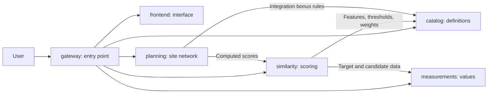

# Service responsibilities

The current architecture runs **six services, including four backend APIs**. All source remains in the same GitHub repository; separate repositories are not required.

For the active lunar task pages, catalog owns `/lunar-handoff` (four definitions, ten lunar references and suitability assessments). Measurements owns `/lunar-handoff` (reviewed rankings) and `/lunar-grid` (global screening data). Similarity fetches both services, validates matching versions and serves `/lunar/tasks/{task_id}?site_id=...`, selecting three new candidates and three least-similar entries from imported rankings. The frontend does no scientific scoring. Planning and the older PDF/observed APIs remain available separately; the active lunar pages do not present their older coverage or sensitivity results as current handoff results. See [LUNAR_METHOD.md](LUNAR_METHOD.md).

A service is a program with a specific job and its own entry point. A Docker container supplies the environment for that program. Compose starts the programs together, connects their network, and waits for dependencies to become healthy.

| Service | Question it answers | Responsibility | Main location |
|---|---|---|---|
| `frontend` | How does a person choose and inspect results? | Vue views, wizard, maps, charts, bilingual UI | `frontend/src/` |
| `gateway` | Which service handles this URL? | One localhost:8080 entry point and API routing | `gateway/` |
| `catalog` | What are we testing? | Missions, feature definitions, sources, thresholds, default weights, method text | `services/catalog/` and definition YAML |
| `measurements` | What values do we have? | Earth candidates, target measurements, spectra, series, placeholder flags | `services/measurements/` and measurement JSON/YAML |
| `similarity` | How similar is each site to the target? | Feature/test scores, overall ranks, explanations, series summaries, robustness | `services/similarity/app/core/` |
| `planning` | Which sites should we visit? | Minimum set cover, fixed-k marginal benefit, weight sensitivity | `services/planning/app/core/` |

`ingest` is an optional seventh role, run once with the `ingest` Compose profile. It downloads public LOLA, Copernicus and POWER products, processes terrain windows and writes scoped observations. It is not a seventh always-running web service. See [DATA_INGESTION.md](DATA_INGESTION.md).

## What happens when someone calculates results?



1. The interface obtains missions and available tests from catalog.
2. After a target is selected, similarity obtains definitions and values from catalog and measurements, then scores each candidate.
3. Planning consumes similarity results and chooses a minimum site network. It does not duplicate the scoring formulas.
4. The interface renders rankings, coverage, and charts.

A planning request currently asks similarity to calculate scores again. Loading rankings and planning concurrently can therefore score twice. This is acceptable for 20 candidates. Versioned score snapshots or result IDs can later avoid duplication and ensure the same dataset version is used throughout.

## Why these boundaries?

Previously, similarity read measurement files, scored sites, selected networks, and ran sensitivity analysis. The new boundaries let a data team own measurements, a methods team own similarity, and a planning team own selection methods. Each backend has its own Dockerfile, dependency list, health endpoint, and OpenAPI schema.

Within a service, small modules remain useful: scoring, weights, aggregation, and time series. Adding a feature scorer changes one module without adding another network service.

## Where to make changes

| Change | Location |
|---|---|
| Add a lunar test or revise a NASA source | `data/seed/tasks_moon.yaml`, `data_sources.yaml`, served by catalog |
| Add a Mars target name or coordinates | `data/seed/target_sites.yaml`, served by catalog |
| Replace Earth/planetary measurements | Candidate JSON and target measurement YAML, read by measurements |
| Change spectral/profile similarity | `services/similarity/app/core/scoring.py` |
| Change weights or feature aggregation | similarity `weights.py` and `aggregate.py` |
| Change the smallest-site selection method | `services/planning/app/core/optimize.py` |
| Change weight sampling | `services/planning/app/core/sensitivity.py` |
| Change cards, maps, or UI wording | `frontend/src/` |
| Add an API route or change service addresses | gateway config; also Vite proxy for local mode |

`services/shared/` contains shared API contracts and the catalog HTTP client. It is a library, not a container, and does not read measurement files. Backend images copy only their own service and shared code, keeping service code dependencies explicit.

Catalog and measurements currently mount the same data directory read-only, but each reads its own files. Similarity and planning have no data mount and obtain data over HTTP. These boundaries can later support database-backed repositories.

## Routes and ports

| Service | Public prefix | Local non-Docker port | Container port |
|---|---|---|---|
| catalog | `/api/catalog` | 8001 | 8000 |
| measurements | `/api/measurements` | 8003 | 8000 |
| similarity | `/api/similarity` | 8002 | 8000 |
| planning | `/api/planning` | 8004 | 8000 |

Append `/docs` for API documentation or `/health` for status. Docker publishes only gateway port 8080. Containers communicate using names such as `http://measurements:8000`; their isolated network environments allow each backend to use internal port 8000.

- Measurements: `GET /snapshot`, `/candidates`, `/candidates/{id}`, `/targets/{id}`.
- Similarity: `POST /score`, `GET /candidates/{id}/series/{feature_id}`.
- Planning: `POST /optimize`, `POST /sensitivity`.
- Catalog: existing missions, tasks, sites, limits, sources, method, and related content routes.

The gateway retains `/api/similarity/optimize` and `/api/similarity/sensitivity` as aliases to planning. The frontend uses `/api/planning`; direct calls to the similarity container expose only its scoring and series routes.

## Manage individual services

```powershell
docker compose ps
docker compose logs -f measurements
docker compose logs -f similarity planning
docker compose up -d --build planning
```

The last command rebuilds planning and starts required dependencies when needed. After changing data files, reload data owners and downstream caches together:

```powershell
docker compose restart catalog measurements similarity planning
```

Definition and measurement HTTP caches default to 60 seconds. Dataset version consistency, pagination, and snapshot retrieval for larger collections remain future improvements.


Catalog additionally owns `/datasets`, `/research`, `/translations/zh-TW` and translated methodology. Measurements owns `/observations`, separate from `/snapshot`. The frontend charts observed distributions and climate context, but does not calculate scientific mission similarity in Vue. The default web stack still has six services.


Current measurement runtime: `/snapshot` reads only `data/observed/mission-measurements.json`; `/coverage` and `/products` expose feature pairings and quality/provenance. Similarity requires matching eligible quantities and returns null complete scores for missing features. Planning uses complete task scores only. Legacy demo measurement files have no runtime reader. See `OBSERVED_DATA.md`.
