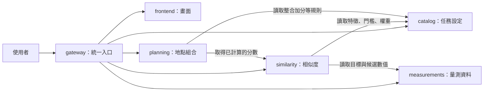

# 服務分工：誰負責什麼？

這份文件描述目前已實作的分工。原始 `SPEC.md` 保留不變，服務邊界依後續討論更新成 **6 個運行中的服務，其中 4 個是後端 API**。所有程式仍放在同一個 GitHub 儲存庫，不需要分成六個 repo。

可以把服務想成各自執行、有自己入口與工作範圍的小程式。Docker 容器是執行每個小程式的環境；Compose 負責一次把它們啟動、接上網路並等待依賴就緒。

| 服務 | 它回答的問題 | 負責內容 | 修改位置 |
|---|---|---|---|
| `frontend` | 使用者怎麼選、怎麼看？ | Vue 畫面、步驟、語系、地圖與圖表 | `frontend/src/` |
| `gateway` | 這個網址該找誰？ | 單一 localhost:8080 入口、把 API 分配到各服務 | `gateway/` |
| `catalog` | 我們要測試什麼？ | 月球／火星任務、特徵定義、來源、門檻、權重預設、方法文件 | `services/catalog/` 與設定 YAML |
| `measurements` | 我們手上有哪些數值？ | 地球候選、目標地點量測、光譜與時間序列、placeholder 標記 | `services/measurements/` 與量測 JSON/YAML |
| `similarity` | 每個地點與目標有多像？ | 特徵評分、任務分數、整體排名、差異解釋、序列圖表統計、穩健性 | `services/similarity/app/core/` |
| `planning` | 要去哪幾個地點測試？ | 最小集合覆蓋、固定 k 邊際效益、權重敏感度 | `services/planning/app/core/` |

未來的 `ingest` 是第七個角色，負責下載與整理真實衛星資料。目前依原規格只保留 README，不啟動容器。

## 點一下「計算」會發生什麼？



1. 畫面先向 catalog 取得任務與可選特徵。
2. 使用者選好目標後，similarity 向 catalog 與 measurements 取資料，計算每個候選的分數。
3. planning 向 similarity 取得分數，再挑出最少地點組合；它不另寫一份相似度公式。
4. 畫面把排名、覆蓋度與圖表呈現出來。

目前 planning 的請求會向 similarity 重新取一次分數，所以前端同時載入排名與規劃時，可能計算兩次。20 個候選的原型可接受；日後可用版本化 score snapshot／結果 ID 避免重算，同時確保規劃使用同一份資料版本。

## 為什麼從原本的四個服務拆成六個？

原先 similarity 同時讀量測檔、算分數、找組合、跑敏感度，修改範圍容易混在一起。現在資料團隊可以維護 measurements，方法團隊維護 similarity，規劃方法由 planning 負責。各自有 Dockerfile、依賴清單、health 與 OpenAPI。

同一服務內仍保留小模組：scoring、weights、aggregate、timeseries 等。新增一種特徵評分時，只需替換 similarity 的 scorer；不用替每條公式增加一個網路服務。

## 實際修改對照

| 想做的變更 | 應修改的位置 |
|---|---|
| 月球多一個測試項目、換 NASA 來源 | `data/seed/tasks_moon.yaml`、`data_sources.yaml`，由 catalog 提供 |
| 新增火星目標地點名稱與座標 | `data/seed/target_sites.yaml`，由 catalog 提供 |
| 換成真實的地球或行星數值 | 候選 JSON、目標量測 YAML，經 measurements 載入 |
| 改光譜相似度或剖面公式 | `services/similarity/app/core/scoring.py` |
| 改整體加權、任務幾何平均 | similarity 的 `weights.py`、`aggregate.py` |
| 改「怎樣選最少地點」 | `services/planning/app/core/optimize.py` |
| 改權重抽樣方法 | `services/planning/app/core/sensitivity.py` |
| 換地圖、改卡片或語系 | `frontend/src/` |
| 加 API 路徑或更換服務網址 | gateway 設定；本機非 Docker 模式也更新 Vite proxy |

`services/shared/` 存放共用 API 資料格式與 catalog HTTP client；它是程式庫，不是容器，也不讀量測檔。後端 Docker image 只複製自己的服務與 shared，避免意外依賴其他服務的程式碼。

catalog 與 measurements 目前共同唯讀掛載 data 目錄，但各讀各自的檔案。similarity、planning 已移除資料掛載，透過 HTTP 取資料。未來可沿同一邊界把資料存放換成資料庫。

## API 與埠號

| 服務 | 對外網址前綴 | 非 Docker 開發埠 | 容器內埠 |
|---|---|---|---|
| catalog | `/api/catalog` | 8001 | 8000 |
| measurements | `/api/measurements` | 8003 | 8000 |
| similarity | `/api/similarity` | 8002 | 8000 |
| planning | `/api/planning` | 8004 | 8000 |

每個前綴後面加 `/docs` 是操作文件，`/health` 是健康檢查。Docker 只對主機開放 gateway 的 8080；容器之間用服務名稱連線，例如 `http://measurements:8000`。各容器擁有自己的網路環境，所以內部都用 8000 不會互相搶埠。

正式 API：

- measurements：`GET /snapshot`、`GET /candidates`、`GET /candidates/{id}`、`GET /targets/{id}`。
- similarity：`POST /score`、`GET /candidates/{id}/series/{feature_id}`。
- planning：`POST /optimize`、`POST /sensitivity`。
- catalog：維持原有 missions、tasks、sites、limits、sources、method 等內容 API。

舊的 `/api/similarity/optimize` 與 `/api/similarity/sensitivity` 在入口保留轉送，實際由 planning 執行。新前端已使用 `/api/planning`；直接連 similarity 容器只會看見其評分與序列 API。

## 個別管理

```powershell
docker compose ps
docker compose logs -f measurements
docker compose logs -f similarity planning
docker compose up -d --build planning
```

最後一行會重建 planning；Compose 必要時也會啟動依賴。若只改資料檔，重新啟動資料擁有者及兩個下游服務可立即更新量測與定義快取：

```powershell
docker compose restart catalog measurements similarity planning
```

目前 definition／measurement HTTP 快取預設 60 秒。真實資料版本的一致性與大量資料的分頁／快照讀取，是後續可加的能力。
